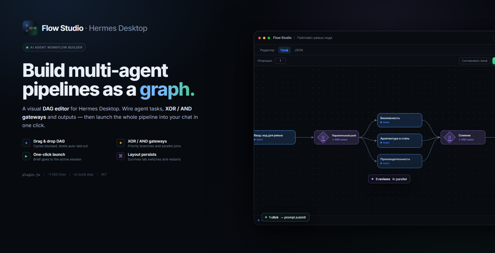
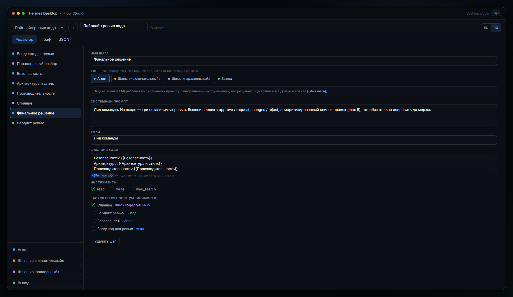
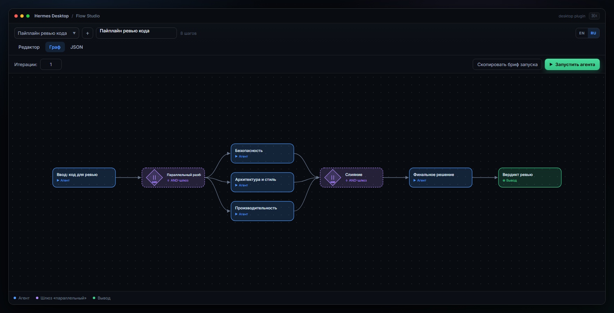
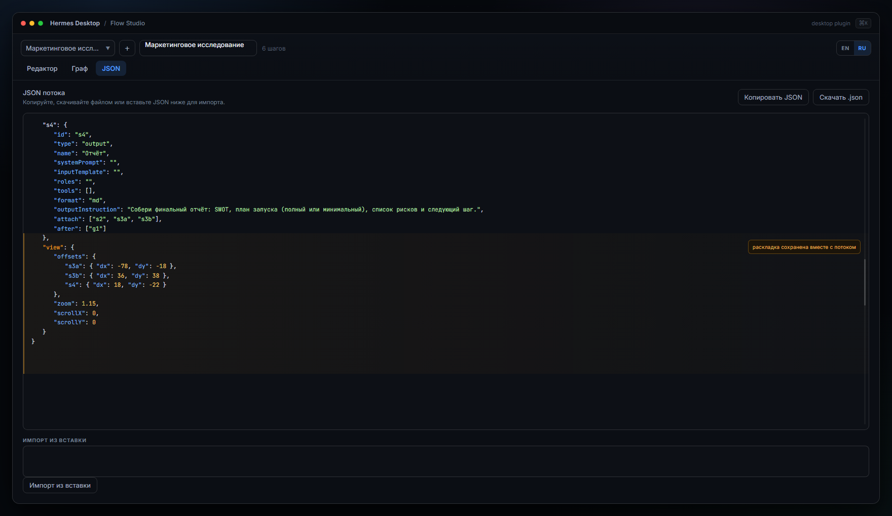
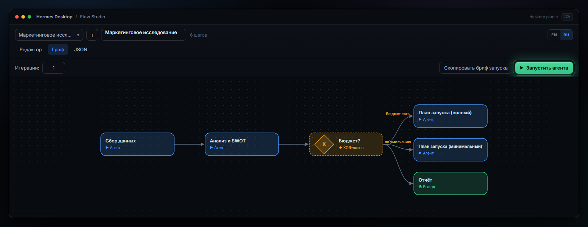
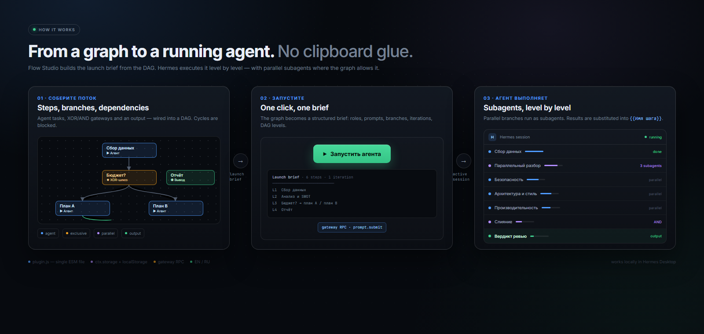
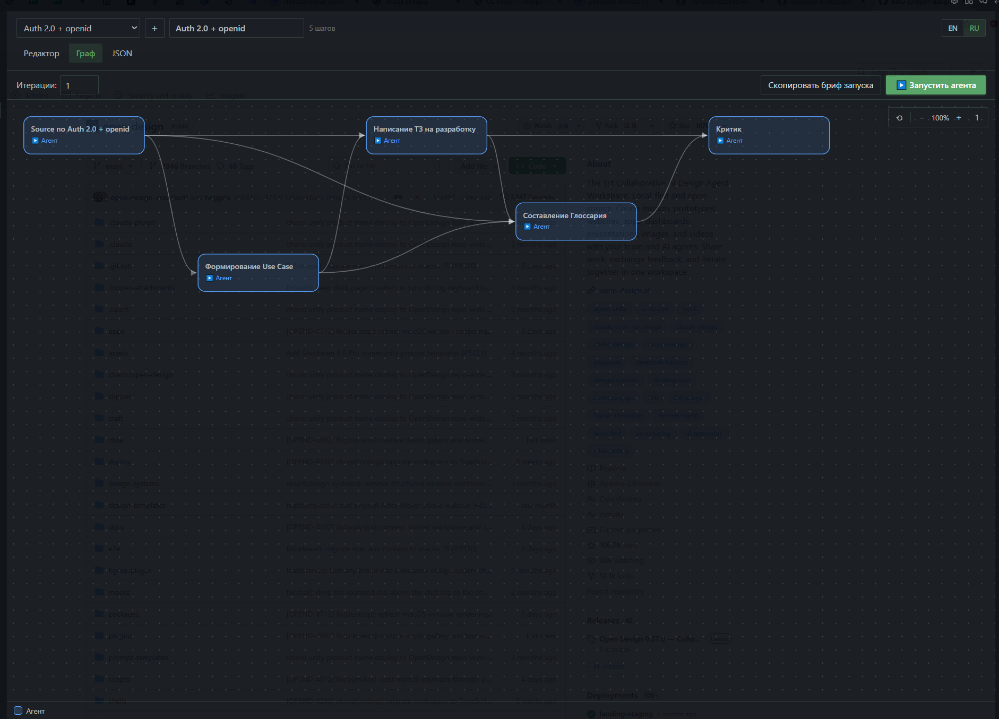
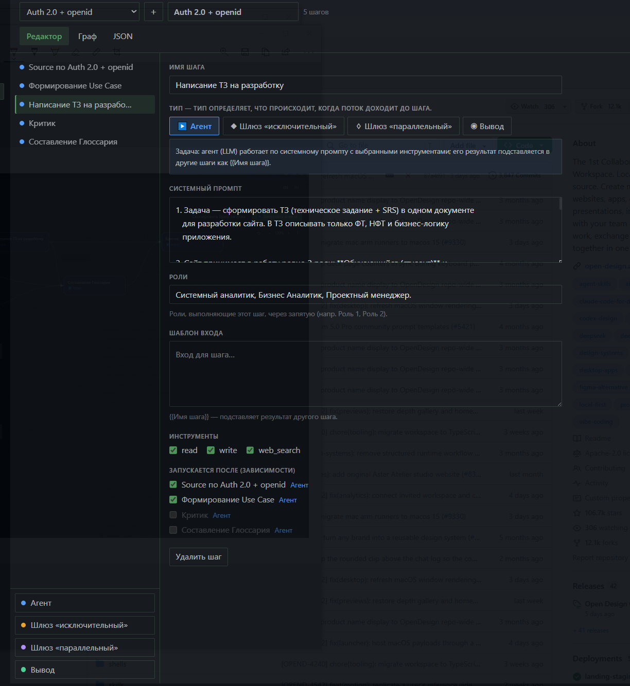
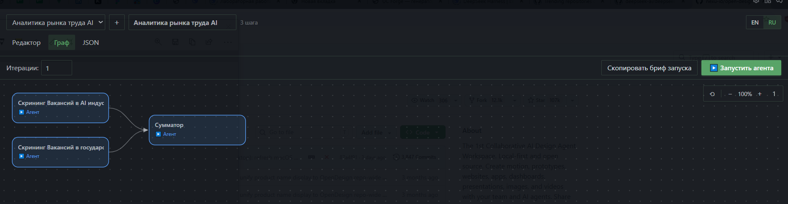

# Flow Studio

<p align="center">
  
</p>

<p align="center">
  <a href="LICENSE"></a>
  
  
  
</p>

---

**Flow Studio** — десктопный плагин для [Hermes Agent](https://hermes-agent.nousresearch.com/): конструктор рабочих процессов, в которых каждая нода — задача для ИИ-агента, а шлюзы — ветвления. Собранный поток отправляется агенту **в один клик** — агент выполняет последовательность сам: subagents, параллельные ветки, XOR/AND-шлюзы.

> Один файл `plugin.js`, ~1 550 строк, **без билд-степа**. UI — прямые `jsx()`-вызовы (ESM грузится uncompiled), стили — scoped CSS на дизайн-токенах хоста (тёмная/светлая тема из коробки).

**Содержание:** [Возможности](#возможности) · [Установка](#установка) · [Быстрый старт](#быстрый-старт) · [Примеры](#примеры) · [Формат потока](#формат-потока-json) · [Технические решения](#технические-решения) · [Roadmap](#roadmap) · [Лицензия](#лицензия)

---

## Возможности

| Вкладка | Что умеет |
|---|---|
| **Editor** | Шаги BPMN-типа: `agent` (system prompt, input-шаблон `{{Имя шага}}`, роли, инструменты `read/write/web_search`), `exclusive` (XOR с приоритетными ветками), `parallel` (AND — ветки сходятся), `output` (сборка результата). DAG-зависимости «runs after» с запретом циклов. |
| **Graph** | Авто-топологическая раскладка SVG, стрелки, семантические цвета типов. Drag & drop, авто-расширение полотна, зум 40–250 % (Ctrl+колесо), автопрокрутка за блоком. **Раскладка (координаты/зум/скролл) сохраняется на поток** — переживает переключение вкладок и перезапуск приложения. |
| **JSON** | Экспорт/импорт потока в один клик, скачивание файла. Раскладка (`view`) едет вместе с файлом. |
| **Запуск** | `▶ Запустить агента` — бриф из графа уходит в активную сессию через gateway RPC `prompt.submit` (тот же вызов, что и композер). Fallback — копирование в буфер. |
| **i18n** | EN/RU в шапке, по умолчанию язык приложения, выбор запоминается. |
| **Персистентность** | `ctx.storage` + localStorage-fallback; потоки, активный поток, язык и раскладка сохраняются между перезапусками. |

### Вкладки

| | | |
|---|---|---|
|  |  |  |
| <sub><b>Editor</b> — шаги, промпты, DAG</sub> | <sub><b>Graph</b> — авто-раскладка, drag&drop</sub> | <sub><b>JSON</b> — экспорт/импорт</sub> |

<p align="center">
  
</p>

<sub align="center"><i>Панель запуска: бриф из графа уходит в активную сессию одним кликом.</i></sub>

<details>
<summary><b>Архитектура запуска</b> (раскрыть)</summary>

<p align="center">
  
</p>

</details>

### Как это выглядит

```
   ┌─────────────┐      ┌──────────┐      ┌─────────────┐
   │ Agent 1     │      │  ◇ XOR   │◄─────┤ Agent 2     │
   │ «Сбор данных»│─────►│  Бюджет? │──────►│ «Анализ»    │
   └─────────────┘      └────┬─────┘      └─────────────┘
                             │ да            │
                             ▼               ▼
                      ┌─────────────┐  ┌─────────────┐
                      │ Agent 3a    │  │ Agent 3b    │
                      │ план (полный)│ │ план (миним.)│
                      └──────┬──────┘  └──────┬──────┘
                             ▼                 ▼
                          ┌─────────────────────────┐
                          │ ◉ Output «Отчёт»        │
                          └─────────────┬───────────┘
                                        ▼
                            ▶ Запустить агента
                            (gateway RPC → сессия)
```

## Установка

Плагин — один файл, положить в:

```
<HERMES_HOME>/desktop-plugins/flow-studio/plugin.js
```

(на Windows: `%LOCALAPPDATA%\hermes\desktop-plugins\flow-studio\plugin.js`), затем **⌘K → Reload desktop plugins**. Пункт появляется в сайдбаре, палитре (`Open Flow Studio`) и по маршруту `/flow-studio`.

### Установка из Git

В Hermes Desktop: **Capabilities → Plugins → Install from Git** → URL этого репозитория → выбрать «desktop plugin» → подтвердить. Или deep-link:

```
hermes://plugin-desktop/repo=Gustafor/Flow_Studio
```

## Быстрый старт (2 минуты)

1. Откройте **Flow Studio** в сайдбаре → **Create flow**.
2. Вкладка **Editor**: добавьте шаги кнопками типов. Для `agent` — `System prompt` и `Input template` (подстановка `{{Имя шага}}`). Для `exclusive` — ветки с условиями (последняя может быть default). Для `output` — формат (`md`/`plain`) и шаги для `Attach`.
3. Установите последовательность в `Runs after` (DAG). Циклы блокируются.
4. Вкладка **Graph**: проверьте раскладку, перетащите блоки — позиция сохранится.
5. **▶ Запустить агента** — бриф уйдёт в текущий чат, агент возьмёт выполнение на себя.

## Примеры

В папке [`examples/`](examples/) — три потока, импортируются в один клик (вкладка **JSON → Import** → вставить содержимое файла):

| Файл | Схема |
|---|---|
| [`marketing-research.json`](examples/marketing-research.json) | Сбор данных → Анализ/SWOT → **XOR «Бюджет?»** → план запуска (полный / минимальный) → отчёт. 6 шагов. |
| [`code-review-pipeline.json`](examples/code-review-pipeline.json) | Ввод кода → **AND**: три независимых ревью (безопасность / архитектура / производительность) → **AND-слияние** → вердикт → документ. 8 шагов. |
| [`content-production.json`](examples/content-production.json) | Тема → черновик → **XOR «Одобрено?»** → доработка → SEO → CTA → публикационный пакет. 7 шагов. |

Все три проходят валидацию импортного пути (`normalizeFlow` + топологическая сортировка): циклов нет, зависимости целы, `view`-раскладка переносится при импорте.

## Формат потока (JSON)

```json
{
  "name": "Пайплайн ревью кода",
  "iterations": 1,
  "steps": {
    "s2": {
      "id": "s2", "type": "agent", "name": "Безопасность",
      "systemPrompt": "Ревьюер безопасности…",
      "inputTemplate": "Код:\n{{Ввод: код для ревью}}",
      "roles": "Security", "tools": ["read", "web_search"],
      "after": ["g1"]
    },
    "g1": { "id": "g1", "type": "parallel", "name": "Параллельный разбор", "after": ["s1"] },
    "g2": {
      "id": "g2", "type": "exclusive", "name": "Одобрено?",
      "branches": [
        { "id": "b1", "target": "s3", "condition": "Да", "isDefault": false },
        { "id": "b2", "target": null, "condition": "", "isDefault": true }
      ],
      "after": ["s2"]
    },
    "s5": {
      "id": "s5", "type": "output", "name": "Вердикт",
      "format": "md", "outputInstruction": "Финальный документ…",
      "attach": ["s2"], "after": ["g2"]
    }
  },
  "view": { "offsets": { "s2": { "dx": 12, "dy": -4 } }, "zoom": 1.2, "scrollX": 0, "scrollY": 0 }
}
```

Типы: `agent` · `exclusive` (branches, приоритет сверху вниз, `isDefault` — fallback) · `parallel` (AND) · `output` (attach-сборка). `after` — DAG «runs after». `view` — сохранённая раскладка (опционально).

## Технические решения

- **Один ESM-файл, без сборки.** Импорты только `@hermes/plugin-sdk`, `react`, `react/jsx-runtime`; JSX-синтаксиса нет — только `jsx()/jsxs()`.
- **Запуск = gateway RPC.** `host.request('prompt.submit', { session_id, text })` — тот же метод, которым работает композер; `host.state.activeSessionId` — живой id сессии. Без активного чата — graceful fallback в буфер.
- **Состояние UI на данных.** Раскладка канваса живёт на объекте потока (`flow.view`) — переключение вкладок (unmount) и перезапуск приложения не сбрасывают её; экспорт/импорт переносят layout.
- **Дизайн-токены хоста.** Вся палитра — `var(--ui-accent)` + `color-mix(in srgb, …)`; тёмная/светлая темы без доработки; `prefers-reduced-motion` уважается.
- **Тесты.** Logic-харнес на Node со stub-ами (jsx/react/SDK) — 50+ ассертов: `topo`/`wouldCycle`, `buildBrief`, `normalizeFlow`/`migrateFlow` (round-trip), рендер Graph (SVG-структура, зум, смещения), иерархия кнопок.

## Roadmap

- [ ] Панорамный сдвиг холста за фон (drag пустого места)
- [ ] Мини-карта для графов 20+ узлов
- [ ] Шаблонизатор брифа (своя промпт-обёртка для всего потока)
- [ ] Импорт из Mermaid / PlantUML
- [ ] Мультипоточный запуск (несколько потоков → одна сессия)

## Реальные скриншоты

Кадр из работающего плагина (не мок-апы) — в `screenshots/real/`:

| Граф (полный экран) | Editor | Панель запуска |
|---|---|---|
|  |  |  |

## Структура репозитория

```
├── plugin.js              # сам плагин (единый файл, ESM)
├── examples/              # 3 готовых потока (JSON, импорт в один клик)
│   ├── marketing-research.json
│   ├── code-review-pipeline.json
│   └── content-production.json
├── screenshots/           # отрендеренные кадры UI
│   └── real/              # реальные скриншоты из работающего плагина
├── assets/
│   ├── logo.svg / logo.png
│   ├── hero.png           # hero-баннер для README
│   ├── social-preview.png # OG-картинка
│   ├── architecture.png   # схема запуска
│   └── src/               # HTML-источники рендер-кита + render.ps1
├── README.md
└── LICENSE                # MIT
```

## Лицензия

[MIT](LICENSE)
